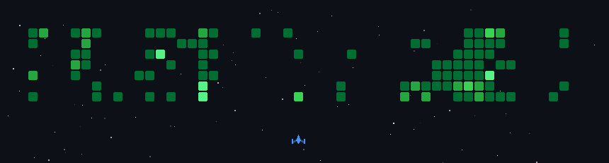

<!-- <a href="https://git.io/typing-svg"></a>

<p align="center">

</p> -->
<!-- #### Hi! I'm Asif
***I build things for the web.*** -->
```bash
asif@dev:~$ whoami

Asif — Full-Stack Enginner/Developer
I build things for the web
```

```yaml
# tech-stack.yml

frontend:      React · Next.js · TypeScript · JavaScript · HTML · CSS · Tailwind CSS
backend:       Node.js · Express.js · Prisma · REST APIs
database:      MongoDB · PostgreSQL · MySQL
languages:     C · C++ · Java · Python
tools:         VS Code · Git · GitHub · Postman
currently:     DSA · Competitive Programming · Backend Engineering
```

```bash
asif@dev:~$ ls ~/projects

BookMyStay/    Job-Portal/    
```

```bash
asif@dev:~$ echo $PHILOSOPHY

"It's a privilege to do hard things. Embrace the struggle. Earn the growth."
```

```bash
asif@dev:~$ exit

Connection to localhost closed.
```

---

<p align="center">
  
</p>
